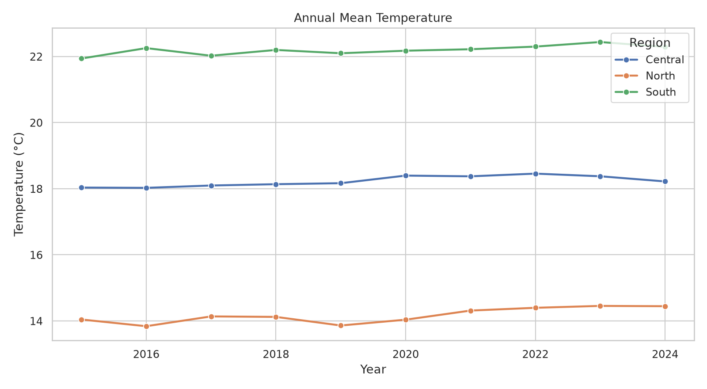
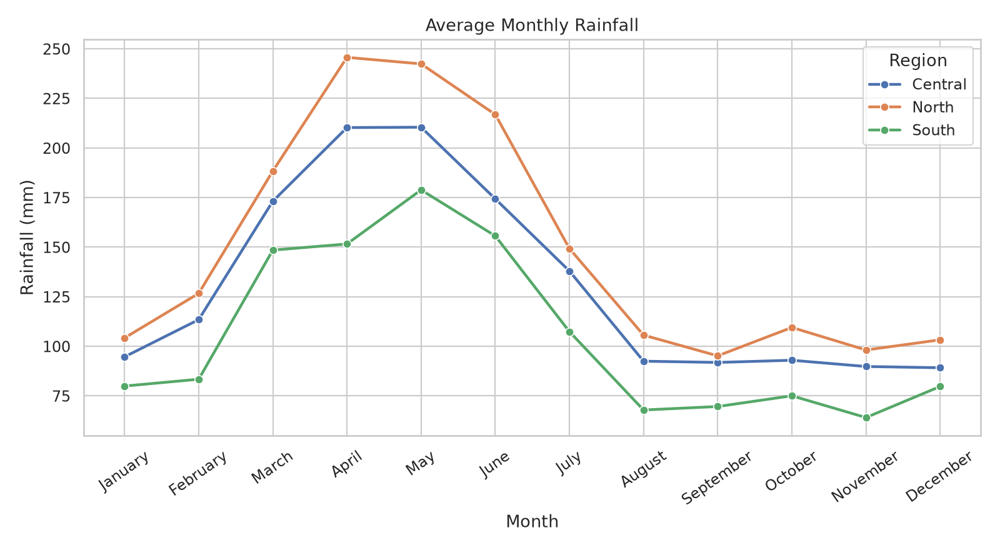
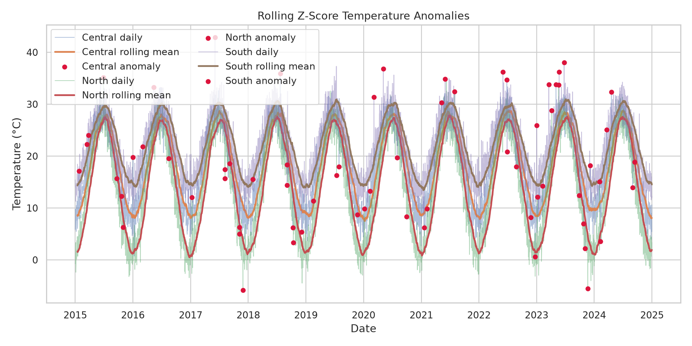
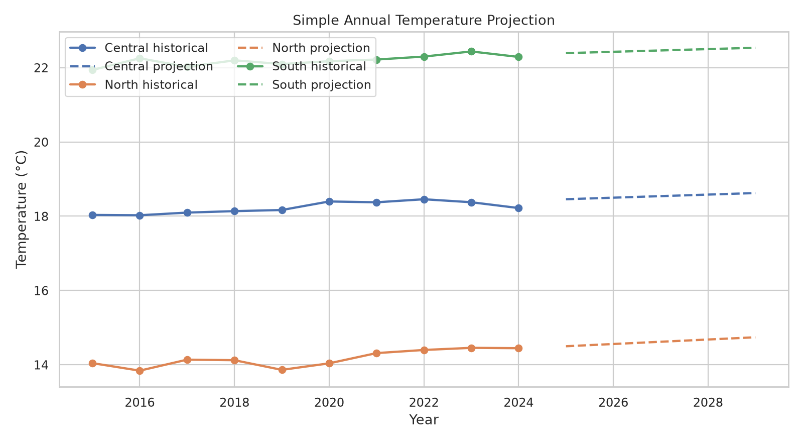

# Climate Trend Analyzer

## Project overview

Climate Trend Analyzer is a small, reproducible Python project that demonstrates a complete data-analysis workflow:

1. generate daily climate-like observations,
2. clean and audit missing values,
3. summarize temperature, rainfall, and humidity,
4. estimate simple temperature trends,
5. flag rolling z-score anomalies,
6. extend the annual trend five years with a transparent linear projection,
7. save tables, charts, and reports, and
8. explore the same workflow in a Streamlit dashboard.

The project is designed for learning, portfolio review, and demonstrations of Python data work. The default dataset is **synthetic/simulated**. It resembles a public daily-observation table, but it is not a government dataset, measured climate record, or source for real-world climate conclusions.

> **Honesty note:** all example results in this README come from the deterministic simulator with the default dates, regions, and random seed. They demonstrate the software pipeline only.

## Why this project is useful

This repository is small enough for a beginner to read from top to bottom, but it still shows the parts of a real analytics project that recruiters often look for:

- a command-line entry point and a browser dashboard,
- configuration with validation,
- separated generation, cleaning, analysis, plotting, and orchestration modules,
- reproducibility through an explicit random seed,
- audit fields for injected anomalies and missing values,
- saved CSV, PNG, JSON, and Markdown artifacts,
- tests for the main behavior, and
- documentation that states the data limitations clearly.

## Simple explanation

Imagine three regions that receive one simulated observation per day. Each observation has a temperature, rainfall amount, and humidity percentage. The generator adds seasonal patterns, regional differences, random noise, a small long-term drift, a few deliberately unusual events, and some missing measurements.

The pipeline then asks:

- Can the missing measurements be filled in transparently?
- What do annual and monthly summaries look like?
- Does a simple straight line describe the annual average temperature?
- Which daily temperatures look unusual compared with a 30-day local baseline?
- What would the same straight line produce for the next five years?

The answer is written to files and displayed in the dashboard. Because the seed is fixed, rerunning the default command produces the same simulated input and the same results on the same software stack.

## Technical explanation

The CLI calls `src.pipeline.run_pipeline()`. The pipeline creates a validated `AnalyzerConfig`, generates daily data with NumPy and pandas, cleans it region by region, computes annual and monthly summaries, fits scikit-learn `LinearRegression` models, applies a 30-observation rolling z-score detector, makes five annual projection rows per region, renders Matplotlib/Seaborn charts, and writes the artifacts listed in [Outputs and results](#outputs-and-results).

The Streamlit app uses the same generator and analysis functions, but keeps the data in memory and exposes controls for region, start date, end date, and random seed. The dashboard is therefore a second interface to the same analysis ideas rather than a separate implementation.

## Quick start

### Windows PowerShell

Run these commands from the project root, the folder containing `main.py`:

```powershell
py -3 -m venv .venv
.\.venv\Scripts\Activate.ps1
py -3 -m pip install -r requirements.txt
py main.py --all
```

If the `py` launcher is unavailable, use `python` in the same commands:

```powershell
python -m venv .venv
.\.venv\Scripts\Activate.ps1
python -m pip install -r requirements.txt
python main.py --all
```

### macOS or Linux

```bash
python3 -m venv .venv
source .venv/bin/activate
python -m pip install -r requirements.txt
python3 main.py --all
```

The CLI creates an `outputs/` directory when it runs. That directory is generated and ignored by Git; it is not a source dataset.

### Launch the dashboard

With the virtual environment active and from the project root:

```bash
streamlit run app/streamlit_app.py
```

On Windows, the equivalent command is also:

```powershell
streamlit run app/streamlit_app.py
```

Streamlit prints a local URL, normally `http://localhost:8501`. Open that URL in a browser. The sidebar controls are:

- **Region:** All regions, North, Central, or South.
- **Start date:** defaults to `2015-01-01`.
- **End date:** defaults to `2024-12-31`.
- **Random seed:** defaults to `42`.

The app shows cleaned-observation count, average temperature, rainfall total, detected anomalies, annual temperature, average monthly rainfall, trend records, projections, and a downloadable `cleaned_climate_data.csv` file.

## CLI reference

The exact help output is available with:

```bash
python main.py --help
```

The entry point accepts:

| Option | Default | Purpose |
| --- | --- | --- |
| `--all` | off as a parser flag | Documents the complete CSV, PNG, JSON, and Markdown artifact workflow. The pipeline writes the full artifact set used by the documented happy path. |
| `--region REGION` | all configured regions | Select one configured region: `North`, `Central`, or `South`. |
| `--start-date YYYY-MM-DD` | `2015-01-01` | Inclusive first date. |
| `--end-date YYYY-MM-DD` | `2024-12-31` | Inclusive last date. |
| `--seed INTEGER` | `42` | Random seed for reproducible simulation. |
| `--output-dir PATH` | `outputs` | Destination for generated artifacts. |

Examples:

```bash
# Default ten-year, three-region artifact run.
python main.py --all

# Analyze only North and write the artifacts to a separate folder.
python main.py --all --region North --output-dir outputs/north

# Make a smaller, reproducible exploratory run.
python main.py --all \
  --start-date 2020-01-01 \
  --end-date 2021-12-31 \
  --seed 7 \
  --output-dir outputs/two_year_demo
```

On Windows PowerShell, the multiline example can be written as one line or use PowerShell backticks:

```powershell
py main.py --all --start-date 2020-01-01 --end-date 2021-12-31 --seed 7 --output-dir outputs/two_year_demo
```

## Architecture

The project uses a small layered pipeline. `main.py` and `app/streamlit_app.py` are interfaces; the reusable work lives under `src/`.

```text
                  +-----------------------------+
                  |        User interface       |
                  |  python main.py              |
                  |  streamlit run app/...      |
                  +--------------+--------------+
                                 |
                                 v
                  +-----------------------------+
                  |         AnalyzerConfig       |
                  | dates, regions, seed, output |
                  +--------------+--------------+
                                 |
                                 v
                  +-----------------------------+
                  |       data_generator.py      |
                  | seasonal synthetic daily data|
                  | anomaly + missingness flags  |
                  +--------------+--------------+
                                 |
                                 v
                  +-----------------------------+
                  |       data_cleaning.py       |
                  | parse, validate, interpolate,|
                  | median fallback, bounds      |
                  +--------------+--------------+
                                 |
                                 v
                  +-----------------------------+
                  |          analysis.py         |
                  | annual/monthly summaries     |
                  | trends, z-score anomalies,   |
                  | five-year linear projection  |
                  +--------------+--------------+
                                 |
                 +---------------+---------------+
                 |                               |
                 v                               v
      +-------------------------+      +-------------------------+
      |     visualization.py    |      |       pipeline.py       |
      | annual, rainfall,       |      | writes tables, charts,  |
      | anomaly, projection PNGs|      | JSON and Markdown report |
      +-------------------------+      +-------------------------+
```

### Folder tree

```text
Climate Trend Analyzer/
├── app/
│   └── streamlit_app.py          # Interactive dashboard
├── data/
│   └── README.md                 # Data policy and schema notes
├── docs/
│   ├── assets/                    # Curated charts used in the README
│   │   ├── annual-temperature.png
│   │   ├── monthly-rainfall.png
│   │   ├── temperature-anomalies.png
│   │   └── temperature-projection.png
│   ├── DEMO_SCRIPT.md            # Short recruiter/demo walkthrough
│   └── PROJECT_GUIDE.md          # Beginner tutorial and presentation guide
├── src/
│   ├── __init__.py
│   ├── analysis.py               # Summaries, trends, anomalies, projection
│   ├── config.py                 # Validated runtime configuration
│   ├── data_cleaning.py          # Cleaning and audit report
│   ├── data_generator.py         # Deterministic synthetic observations
│   ├── pipeline.py               # End-to-end orchestration and file writing
│   └── visualization.py          # Saved Matplotlib/Seaborn charts
├── tests/
│   └── test_pipeline.py          # Four behavior-focused tests
├── .gitignore
├── main.py                       # CLI entry point
├── requirements.txt
└── README.md
```

Generated `outputs/` is intentionally absent from the source tree until the first CLI run.

## Simulation and dataset details

### What is simulated

The generator creates one row per day for every configured region. With the defaults, the inclusive date range contains 3,653 dates and three regions, so the raw and cleaned tables each contain 10,959 observations unless a caller changes the dates or regions.

The measurement columns are:

| Column | Meaning | Unit / behavior |
| --- | --- | --- |
| `temperature_c` | Simulated daily temperature | °C; regional offset, seasonal wave, small time drift, and random noise |
| `rainfall_mm` | Simulated daily rainfall | mm; non-negative gamma-distributed base scaled by region and season |
| `humidity_pct` | Simulated daily relative humidity | percent; clipped to 15-100 during generation and bounded to 0-100 during cleaning |

The generator also includes:

- `date`, `region`, `season`, `year`, `month`, `month_name`, `quarter`, and `day_of_year`;
- `is_injected_anomaly`, a ground-truth flag for deliberately altered events; and
- `is_missing_injected`, a flag for rows where at least one measurement was set to missing.

The default named profiles are:

- **North:** cooler temperature offset, larger seasonal range, higher rainfall factor, and higher humidity offset;
- **Central:** baseline profile; and
- **South:** warmer temperature offset, smaller seasonal range, lower rainfall factor, and lower humidity offset.

For each region, about 0.8% of daily rows receive an injected event. The event shifts temperature, multiplies rainfall, and changes humidity. About 1.2% of cells in each measurement column receive missing values independently. These rates are simulation settings, not estimates of real climate data quality.

### Cleaning behavior

`clean_data_with_report()`:

1. checks that the date, region, and three measurement columns exist;
2. parses dates and strips region labels;
3. drops rows with invalid dates or empty regions;
4. sorts by region and date;
5. records row-level imputation markers;
6. interpolates missing measurements within each region in date order;
7. uses a region median, then a global/fallback value, if interpolation cannot fill a value;
8. clips rainfall to a minimum of zero and humidity to 0-100;
9. restores calendar columns; and
10. returns a `CleaningReport` with before/after row counts and missingness totals.

### Analysis methods

- **Annual summary:** one row per region and year with mean/min/max temperature, total rainfall, mean humidity, record count, and detected-anomaly count when available.
- **Monthly summary:** one row per region, year, and month with mean temperature, total rainfall, mean humidity, and record count.
- **Trend:** ordinary least-squares linear regression of annual mean temperature against year. The slope is reported in °C per year and the output includes `r_squared` and a simple `warming`, `cooling`, or `stable` label.
- **Anomaly detector:** a 30-observation rolling mean and population standard deviation per region. The default threshold is an absolute z-score of at least 3.0. The first rows use the available observations and a zero z-score when the rolling standard deviation is zero.
- **Projection:** the annual linear model is extended five years after the last observed year. Projection rows set `forecast_type` to `projection` and leave `actual_temperature_c` empty.

These choices are intentionally easy to inspect and explain. They are educational baselines, not a climate-science forecasting system.

## Outputs and results

The default command writes these exact relative paths under `outputs/`:

| Output path | Format | Contents |
| --- | --- | --- |
| `outputs/synthetic_climate_data.csv` | CSV | Generated observations before cleaning |
| `outputs/cleaned_climate_data.csv` | CSV | Cleaned observations with audit/calendar fields |
| `outputs/annual_summary.csv` | CSV | Annual region-level aggregates |
| `outputs/monthly_summary.csv` | CSV | Monthly region-level aggregates |
| `outputs/temperature_trends.csv` | CSV | One linear trend record per selected region |
| `outputs/temperature_anomalies.csv` | CSV | Daily rolling statistics and anomaly flags |
| `outputs/temperature_projection.csv` | CSV | Historical annual values plus five projection years |
| `outputs/annual_temperature.png` | PNG | Annual mean temperature chart |
| `outputs/monthly_rainfall.png` | PNG | Average monthly rainfall profile |
| `outputs/temperature_anomalies.png` | PNG | Daily temperature, rolling baseline, and detected points |
| `outputs/temperature_projection.png` | PNG | Historical annual means and dashed projections |
| `outputs/analysis_report.json` | JSON | Machine-readable configuration, counts, trends, projections, and output paths |
| `outputs/analysis_report.md` | Markdown | Human-readable run report with scope, quality, trends, anomalies, projections, and saved artifacts |

### Verified default run

The following was run from the project root with `python main.py --all --output-dir /tmp/climate-trend-analyzer-doc-check` while preparing this documentation. The output directory was outside the repository so generated artifacts would not be mixed with source files.

```text
Analyzed 10,959 cleaned daily observations.
Regions: Central, North, South
Detected anomalies: 67
```

The corresponding report contained:

- 10,959 rows before cleaning and 10,959 after cleaning;
- 0 invalid rows dropped;
- 397 rows with at least one imputed measurement;
- 0 missing measurement values after cleaning;
- 30 annual summary rows, 360 monthly summary rows, 10,959 anomaly-analysis rows, and 45 projection rows;
- 87 deliberately injected anomaly rows available for comparison; and
- warming-labeled synthetic trends for all three default regions: approximately `0.0604 °C/year` for North, `0.0416 °C/year` for Central, and `0.0362 °C/year` for South.

Those numbers describe one seeded simulation. They do **not** describe observed regional warming and should not be cited as climate measurements.

## Dashboard and screenshots

The dashboard is available locally after running:

```bash
streamlit run app/streamlit_app.py
```

It provides interactive controls and charts for the same in-memory workflow. The app does not read a government dataset from `data/`; it regenerates simulated observations for the selected controls.

### Curated chart assets

The following charts are generated from the default seeded run and copied into `docs/assets/` so a GitHub visitor can see the project before running it. They are illustrative outputs from simulated data, not observed climate records.

| Asset | What it demonstrates |
| --- | --- |
|  | Regional annual mean temperature comparison |
|  | Seasonal rainfall pattern |
|  | Rolling baseline and detected anomaly points |
|  | Historical values plus transparent linear projections |

For a real portfolio presentation, also capture a browser screenshot of the Streamlit dashboard and a terminal screenshot showing `python main.py --all`; store those as `docs/assets/dashboard-overview.png` and `docs/assets/cli-output.png` after labeling them as simulated data.

## Tests

Run the existing test suite from the project root:

```bash
python -m pytest -q
```

The current tests cover:

- daily generation, regions, seasons, injected anomalies, and missingness;
- cleaning, imputation, and physical bounds;
- anomaly detection and future projection rows; and
- end-to-end artifact creation, region filtering, and JSON report contents.

## Future work

Possible next steps, kept separate from the current synthetic demo, include:

1. add an explicit input adapter for a documented real dataset such as NOAA or another licensed source;
2. preserve source metadata, units, timezone, station identifiers, and provenance when real data is used;
3. add cross-validation, confidence intervals, baseline comparisons, and model diagnostics;
4. compare the linear projection with a stronger time-series baseline;
5. add user-configurable anomaly windows and metrics beyond temperature;
6. add an export/download page for all dashboard tables and figures;
7. add automated linting, type checking, CI, and a deployment workflow; and
8. add a small screenshot gallery or hosted dashboard only after the data and hosting terms are clear.

## Learning outcomes

After studying or extending this project, a beginner can explain and demonstrate:

- how to create and use a Python virtual environment;
- how a pandas DataFrame moves through generation, cleaning, aggregation, and export;
- why random seeds matter for reproducible experiments;
- how missing-value imputation should be recorded rather than hidden;
- how to build a simple trend model with scikit-learn;
- how rolling statistics can support anomaly flags;
- how to turn reusable Python functions into both a CLI and a Streamlit interface;
- how to save results in analysis-friendly formats; and
- how to communicate the boundary between a software demonstration and real scientific evidence.

## Limitations

- The default data is simulated, not collected from government stations or sensors.
- The regional profiles and seasonal formulas are hand-authored assumptions.
- The random generator includes injected anomalies and missing cells for teaching; they are not discovered events from a real record.
- Linear regression uses year as its only predictor and does not establish causation.
- Five-year projections are extrapolations from the synthetic annual line, not validated forecasts.
- The rolling z-score detector is sensitive to its window and threshold and is not a complete anomaly-detection method.
- No uncertainty intervals, station effects, spatial dependence, or physical climate model are implemented.
- Results can vary if the date range, seed, dependency versions, or configuration changes.

## Author

**Author:** Your Name  
**Portfolio:** `https://github.com/your-username`  
**LinkedIn:** `https://www.linkedin.com/in/your-username/`

Replace these placeholders before publishing the repository. For a guided walkthrough and interview preparation, see [`docs/PROJECT_GUIDE.md`](docs/PROJECT_GUIDE.md). For a short live presentation, see [`docs/DEMO_SCRIPT.md`](docs/DEMO_SCRIPT.md).

